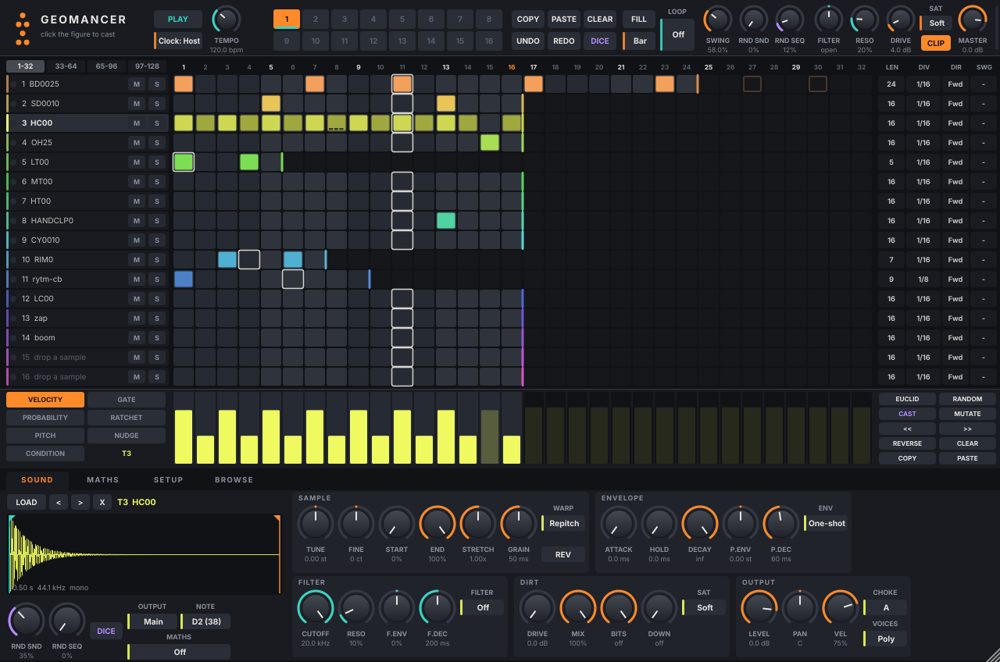

# Geomancer

A drum machine plugin: 16 tracks of samples, a step sequencer inspired by the Arturia
DrumBrute and Beatstep Pro, randomizers, and a MATHS-style "emergent rhythm" generator.
Works as a plugin in REAPER (or most other music programs) and as a standalone app.



## Install it

1. Open the **[Releases page](../../releases/latest)** and download the zip for your computer:
   **Windows**, **macOS** or **Linux**.
2. Unzip it. Inside the `Geomancer` folder you'll find the plugin, **`Geomancer.vst3`**.
3. Copy `Geomancer.vst3` into your computer's VST3 folder:

   | Computer | Put `Geomancer.vst3` here |
   |---|---|
   | **Windows** | `C:\Program Files\Common Files\VST3` |
   | **macOS** | `/Library/Audio/Plug-Ins/VST3` (for Logic / GarageBand, also copy `Geomancer.component` into `/Library/Audio/Plug-Ins/Components`) |
   | **Linux** | `~/.vst3` (make the folder if it isn't there) |

4. Open your music program and let it **rescan plugins**. In REAPER: *Options → Preferences → Plug-ins →
   VST → Re-scan*. Then add **Geomancer** to a track like any instrument.

No music program? Run the **standalone app** from the same zip (`Geomancer.exe` / `Geomancer.app` /
`Geomancer-standalone`) and press PLAY.

> **macOS says the app "can't be opened" or "is damaged"?** It isn't, but it isn't signed by Apple either.
> Open *Terminal* and run `xattr -cr /Library/Audio/Plug-Ins/VST3/Geomancer.vst3` (and the same for the
> `.component` / `.app` if you use them), then try again.
>
> **Windows SmartScreen warning on the app?** Click *More info → Run anyway*.

## First five minutes

1. A new Geomancer comes **loaded with a built-in drum kit**. Click squares in the grid to turn steps on.
2. Press play in your music program (or the **PLAY** button in Geomancer). The beat follows your project's tempo.
3. Click the **dot figure** top-left for an instant random beat. Click it again for another one.
4. Click a track name, then twist the knobs at the bottom to change its sound.
5. Use your own samples: the **BROWSE** tab lets you click through your sample folders and hear them; press
   Enter to load one into the selected track. You can also drag files or whole folders onto the grid.

## What's in it

- **16 sample tracks.** Each track has repitch or granular time-stretch, reverse, start/end points,
  attack/hold/decay, a pitch envelope, a multimode filter with its own envelope, bitcrush and
  downsampling, five kinds of saturation, choke groups, and its own output (for stems).
- **A DrumBrute / Beatstep Pro style sequencer.** 16 patterns × 16 tracks × 128 steps (8 bars of 16ths).
  - Per track: length, division (1/2 … 1/64, triplets, dotted), direction (fwd/rev/ping-pong/random)
    and swing.
  - Per step: velocity, gate, probability, ratchet (1-8), pitch, micro-timing nudge, and
    Elektron-style conditions (1:2 … 4:4, Fill, First).
  - Fill, chains, a looper (beat repeat), undo/redo.
- **Randomness, per track and global.** *Rnd Snd* varies each hit (pitch, filter, decay, start,
  pan, level). *Rnd Seq* drops steps, adds ghost notes, humanizes timing and velocity, and throws in
  ratchets. *Lock* makes it repeat exactly, so what you hear is what REAPER renders. DICE buttons
  roll whole beats or sounds.
- **MATHS (emergent rhythm).** Two rise/fall function generators that can loop (CYCLE), trigger each
  other, and speed each other up or slow each other down (X-MOD). The end of a rise or cycle fires
  tracks; their levels modulate pitch, cutoff, decay, level, pan, start, drive or density. Start from
  the RECIPES menu.
- **Geomancy.** Click the figure in the logo to cast a geomantic shield chart: four random Mothers
  generate 16 figures × 4 rows = 64 steps, dealt across the kit. The Judge's name shows under the
  logo.
- **Built-in synth kit.** A new instance comes loaded with 14 synthesized drums (kick, snare,
  hats, clap, toms, rim, cowbell, cymbal, shaker, zap, sub boom), so it makes sound right away. Drop
  your own samples over them.

## Pattern length
Each row has a bright **end bracket**: drag it to change that track's length. **Click a step number** in the
ruler to set every track's length at once (shift-click: just the selected track). Steps past the end are
kept (hollow outlines) and come back when you lengthen the track, so you can write long and trim later.

## Browsing samples
The **BROWSE** tab lists every drive (from the mount table: /mnt/*, /media/*, network shares marked) plus
your favourites. Click or arrow through files to hear them (AUTO PREVIEW), Enter / double-click loads into
the selected track, drag a file onto any grid row, or FOLDER → KIT loads the whole folder into consecutive
tracks. LOAD and double-clicking a track name open the browser at that track's sample. You can also drop
files or folders from your file manager anywhere on the window (folders fill tracks downward; if a folder has
no audio at the top it looks in its subfolders). Favourites and the last folder live in
`~/.config/Geomancer/Geomancer.settings`.

## Grid cheat sheet
Click = on/off · drag = paint · shift-drag or mouse wheel = velocity · right-click a step = all of its
options · right-click a track name = track tools (Euclid, random, cast, shift, length, copy/paste).
Drag LEN / SWG up and down; click DIV / DIR for a menu. Drop samples or a whole folder onto the rows.
Shift-click pattern slots to build a chain. Space = play, Ctrl+Z / Ctrl+Shift+Z = undo / redo,
↑/↓ = select track, ←/→ = previous / next page of 32 steps.

## Using it in REAPER

| Want | Do |
|---|---|
| Play patterns in sync | Just press play. The sequencer locks to REAPER's transport and tempo, including tempo changes, loops and offline render. |
| Audition without rolling the transport | Hit **PLAY** in the plugin. It runs at the project tempo until REAPER starts. |
| Arrange a song | Put notes **0-15** in a MIDI item on the Geomancer track: note N selects pattern N+1, switching on the SWITCH grid (Bar by default). Hold note **16** for FILL. |
| Play/sequence the pads from REAPER's piano roll | Notes 36-51 (C2-D#3) hit tracks 1-16 (each track's note is set under NOTE). Turn off *SEQ PLAYS SOUNDS* if you only want REAPER's MIDI. |
| Record the sequencer as MIDI | Setup → *SEQ → MIDI OUT*, then set the track's record mode to **Record: output (MIDI)** and arm it. |
| Record per-drum stems | Set a track's **OUTPUT** to Out 1-16, raise the REAPER track's channel count, and route those plugin outputs to their own tracks (or use REAPER's "Build multichannel routing for output of this track"). |
| Automate anything | Every sound/FX/random/MATHS control is a REAPER automation lane. **Pattern** and **Looper** are automatable too. |
| Make random parts render exactly like playback | Setup → *LOCK RANDOMNESS* (change *Seed* for a different take). |

---

## For developers

### Building it yourself

```bash
git clone --recursive https://github.com/shkennedy33/geomancer.git   # JUCE comes in as a submodule
cmake -B build -G Ninja -DCMAKE_BUILD_TYPE=Release
ninja -C build Geomancer_VST3 Geomancer_Standalone   # VST3 auto-installs to ~/.vst3/Geomancer.vst3
```
REAPER picks it up on its next launch as **VST3i: Geomancer (Sequoyah)**. If it doesn't appear, use
Options → Preferences → Plug-ins → VST → *Re-scan*. Standalone app:
`build/Geomancer_artefacts/Release/Standalone/Geomancer`.


### Tests
```bash
build/gm_test_artefacts/Release/gm_test engine samples/dirt     # 47 sample-accurate engine checks
xvfb-run -a build/gm_test_artefacts/Release/gm_test guitest samples/dirt   # synthesized-mouse GUI checks
xvfb-run -a build/gm_test_artefacts/Release/gm_test vst3 ~/.vst3/Geomancer.vst3
tools/reaper_test.sh                                            # headless REAPER: build project, render, verify
xvfb-run -a external/pluginval/pluginval --strictness-level 8 --validate ~/.vst3/Geomancer.vst3
```
`samples/dirt` is a sparse clone of tidalcycles/Dirt-Samples, used only for tests:
`git clone --depth 1 --filter=blob:none --sparse https://github.com/tidalcycles/Dirt-Samples samples/dirt && (cd samples/dirt && git sparse-checkout set 808bd 808sd 808hc 808oh 808cy 808ht 808lt 808mt 808lc 808mc cp rm cb)`
